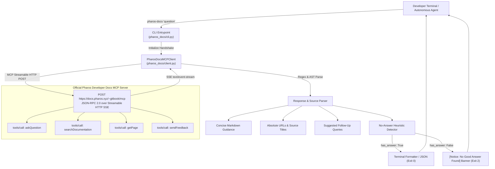

# Pharos Doc-Search CLI (`pharos-docs`)

[](https://pharos-agent-arena.vercel.app/tasks/doc-search-cli)
[-brightgreen.svg)](https://pharos-agent-arena.vercel.app/tasks/doc-search-cli)
[-success.svg)](https://docs.pharos.xyz)
[-orange.svg)](https://docs.pharos.xyz/~gitbook/mcp)
[](LICENSE)
[-blueviolet.svg)](pyproject.toml)

> **A fast, zero-dependency command-line interface and wrapper for the official Pharos Developer Docs MCP server.**
> Built by **[JimmyOgb](https://github.com/JimmyOgb)** for the official **Pharos Season of AI — Agent Arena**.

---

## Overview

The **Pharos Doc-Search CLI** (`pharos-docs`) enables developers, terminal users, and autonomous AI agents to search and inspect official Pharos documentation directly from the command line.

The tool wraps the official **Pharos Developer Docs Model Context Protocol (MCP)** server:
```http
POST https://docs.pharos.xyz/~gitbook/mcp
```
It implements the standard MCP JSON-RPC 2.0 protocol over Streamable HTTP Server-Sent Events (SSE), dynamically discovering and invoking official tools:
- **`askQuestion`**: Synthesizes concise natural language guidance with verified documentation references.
- **`searchDocumentation`**: Performs full-text keyword indexing across the entire documentation set.
- **`getPage`**: Fetches complete documentation pages by path or URL.
- **`sendFeedback`**: Submits developer feedback on documentation accuracy.

Adhering strictly to the **$0-first principles** of the Pharos ecosystem:
- **Zero Third-Party Dependencies**: 100% Python 3.9+ standard library (`urllib.request`, `json`, `argparse`, `re`, `time`). Requires no external SDKs or frameworks.
- **Zero API Keys & Subscriptions**: Direct connection to the public read-only Developer Docs MCP.
- **Zero Blockchain Gas**: Operates on documentation corpora; no wallet or gas required.
- **Honest Detection**: Detects out-of-domain or undocumented queries and exits with status code `2` without fabricating answers.

---

## Architecture



---

## Acceptance Criteria Verification Matrix

| Criterion | Requirement Description | Implementation Status | Evidence / Verification |
| :--- | :--- | :--- | :--- |
| **01** | Accepts a natural-language question as input (`pharos-docs "query"`) | **Verified** | Command line argument in `pharos_docs/cli.py` or piped stdin `-` |
| **02** | Returns concise answer plus links/references to source doc sections | **Verified** | Parsed answer + resolved `[Sources & Documentation References]` to `https://docs.pharos.xyz/...` |
| **03** | Handles *"no good answer found"* gracefully without inventing facts | **Verified** | `NO_ANSWER_PATTERNS` regex matching + `[Notice: No Good Answer Found]` banner, exit code `2` |
| **04** | README with install/usage instructions and live verified examples | **Verified** | Full documentation below with exact terminal output traces |

---

## Installation & Setup

### Method 1: Local Pip Editable Install (Recommended)

From the repository root:

```bash
pip install -e .
```

This installs the console command `pharos-docs` onto your system PATH.

### Method 2: Standalone Direct Invocation (Zero Installation)

Run directly with Python:

```bash
python -m pharos_docs.cli "How do I deploy a contract?"
```

On Windows, you can also execute the included batch script:

```cmd
bin\pharos-docs.cmd "What is the Atlantic testnet RPC URL and chain ID?"
```

---

## Usage Guide

```text
usage: pharos-docs [-h] [--goal GOAL] [--endpoint ENDPOINT] [--timeout TIMEOUT]
                   [--search SEARCH] [--page PAGE] [--list-tools]
                   [--json] [--no-color] [--max-sources MAX_SOURCES] [--version]
                   [query]
```

### Options Reference:

| Flag | Type | Default | Description |
| :--- | :--- | :--- | :--- |
| `query` | `string` | *(required unless `--search`, `--page`, or `--list-tools`)* | Natural-language question to query via Docs MCP `askQuestion` |
| `--goal` | `string` | `develop and verify autonomous AI agents on Pharos` | Developer goal context passed to the MCP tool |
| `--endpoint` | `string` | `https://docs.pharos.xyz/~gitbook/mcp` | Developer Docs MCP server endpoint |
| `--timeout` | `integer` | `35` | HTTP request timeout in seconds |
| `--search` | `string` | `None` | Run full-text search using Docs MCP `searchDocumentation` tool |
| `--page` | `string` | `None` | Fetch complete documentation page using Docs MCP `getPage` tool |
| `--list-tools` | `flag` | `false` | Discover and list tools exposed by the Docs MCP server |
| `--json` | `flag` | `false` | Output machine-readable JSON object |
| `--no-color` | `flag` | `false` | Disable ANSI terminal color sequences |
| `--max-sources` | `integer` | `5` | Maximum number of source references to display |
| `--version` | `flag` | - | Display version information and exit |

---

## Live Verified Examples

All examples below were executed directly against the live official Pharos Developer Docs MCP server (`https://docs.pharos.xyz/~gitbook/mcp`).

### Example 1: Contract Deployment with Foundry / Hardhat

**Command:**
```bash
pharos-docs "How do I deploy a contract?" --no-color
```

**Live Verified Terminal Output:**
```text
=== Pharos Developer Docs Search ===
Query: "How do I deploy a contract?"
Latency: 14.5s | HTTP: 200

[Answer]
You can deploy through Foundry or Hardhat. With Foundry, compile and test your contract, then run a broadcast script against a Pharos RPC endpoint.

1. In your deployment script, load `PRIVATE_KEY`, start broadcasting, and create the contract. The [Write Your First Token](https://docs.pharos.xyz/developer-guide/foundry/write-your-first-token) shows a complete example.
2. Set the key and deploy:

```sh
export PRIVATE_KEY=<your_private_key>
forge script script/DeployToken.s.sol --rpc-url <PHAROS_RPC_URL> --broadcast
```

Make sure the deployer wallet has enough testnet tokens to cover deployment costs. The script output provides the deployed contract address.

For Hardhat, set `PRIVATE_KEY` with `npx hardhat vars set PRIVATE_KEY`, then deploy using the configured Pharos network:

```sh
npx hardhat ignition deploy ./ignition/modules/Token.js --network pharos
```

See the [Write Your First Token](https://docs.pharos.xyz/developer-guide/hardhat/write-your-first-token) for its setup and network configuration.

[Sources & Documentation References]
  1. Write Your First Uniswap Contract
     -> https://docs.pharos.xyz/developer-guide/foundry/write-your-first-uniswap-contract
  2. Write Your First Uniswap Contract
     -> https://docs.pharos.xyz/developer-guide/hardhat/write-your-first-uniswap-contract
  3. Validator Node Deployment
     -> https://docs.pharos.xyz/node-and-validator-guide/validator-node-deployment
  4. Write Your First Token
     -> https://docs.pharos.xyz/developer-guide/foundry/write-your-first-token
  5. Write Your First NFT
     -> https://docs.pharos.xyz/developer-guide/hardhat/write-your-first-nft
  ... and 5 more reference sections.
```

---

### Example 2: Network Parameters & Chain ID

**Command:**
```bash
pharos-docs "What is the Atlantic testnet RPC URL and chain ID?" --no-color
```

**Live Verified Terminal Output:**
```text
=== Pharos Developer Docs Search ===
Query: "What is the Atlantic testnet RPC URL and chain ID?"
Latency: 11.55s | HTTP: 200

[Answer]
The Atlantic testnet RPC URL is `https://atlantic.dplabs-internal.com` and the Chain ID is `688689`. See [Atlantic Testnet](https://docs.pharos.xyz/getting-started/network/atlantic-testnet) for more details.

[Sources & Documentation References]
  1. Atlantic Testnet
     -> https://docs.pharos.xyz/getting-started/network/atlantic-testnet
  2. ZAN RPC
     -> https://docs.pharos.xyz/tooling-and-infrastructure/rpc/zan
  3. x402 Atlantic Testnet
     -> https://docs.pharos.xyz/developer-guide/x402/x402-atlantic-testnet
  4. Node Management
     -> https://docs.pharos.xyz/node-and-validator-guide/node-management
  5. Write Your First Token
     -> https://docs.pharos.xyz/developer-guide/hardhat/write-your-first-token
  ... and 5 more reference sections.
```

---

### Example 3: Honest "No Good Answer Found" Handling

When given an out-of-domain question, `pharos-docs` detects that no confident documentation answer exists, renders the notice banner, clarifies the domain, lists closest reference topics, and exits with status code `2`:

**Command:**
```bash
pharos-docs "What is the recipe for baking chocolate chip cookies on Pharos?" --no-color
```

**Live Verified Terminal Output:**
```text
=== Pharos Developer Docs Search ===
Query: "What is the recipe for baking chocolate chip cookies on Pharos?"
Latency: 12.78s | HTTP: 200

[Notice: No Good Answer Found in Official Docs]
The documentation returned no confident or relevant answer for this specific query:

I cannot find a chocolate chip cookie recipe in the Pharos docs. For building Pharos agents, see the [Pharos Skill Engine](https://docs.pharos.xyz/tooling-and-infrastructure/pharos-skill-engine-guide).

[Sources & Documentation References]
  1. About Pharos
     -> https://docs.pharos.xyz/introduction/readme
  2. Why Pharos
     -> https://docs.pharos.xyz/introduction/why-pharos
  3. x402 Atlantic Testnet
     -> https://docs.pharos.xyz/developer-guide/x402/x402-atlantic-testnet
  4. x402 Pacific Mainnet
     -> https://docs.pharos.xyz/developer-guide/x402/x402-pacific-mainnet
  5. Vision & Mission
     -> https://docs.pharos.xyz/introduction/vision-and-mission
  ... and 5 more reference sections.
```

*Exit code returned: `2` (enables calling scripts and agents to distinguish honest negative results from network errors).*

---

### Example 4: Full-Text Keyword Search (`--search`)

Invokes the official Docs MCP `searchDocumentation` tool:

**Command:**
```bash
pharos-docs --search "Foundry" --no-color
```

**Live Verified Terminal Output:**
```text
=== Pharos Docs Search Results: 'Foundry' (4.33s) ===
Title: Foundry
Link: https://docs.pharos.xyz/developer-guide/foundry
Content: This guide is suitable for developers who want to start building dApps using Pharos and Foundry toolchains. If you are a new user of Ethereum, please consider researching the Ethereum documentation before continuing.

Title: Write Your First NFT
Link: https://docs.pharos.xyz/developer-guide/foundry/write-your-first-nft
Content: Foundry

Title: Write Your First Token
Link: https://docs.pharos.xyz/developer-guide/foundry/write-your-first-token
Content: Foundry
```

---

### Example 5: Direct Page Fetch (`--page`)

Invokes the official Docs MCP `getPage` tool:

**Command:**
```bash
pharos-docs --page "https://docs.pharos.xyz/developer-guide/foundry/write-your-first-token" --no-color
```

**Live Verified Output (Truncated for Brevity):**
```text
=== Pharos Docs Page (2.54s) ===
# Write Your First Token

This guide will walk you through the process of creating and deploying your first token on the Pharos blockchain. By the end of this guide, you will have a fully functional token contract and understand how to interact with it.

### Setup 1: Install Foundry
...
```

---

### Example 6: MCP Tool Discovery (`--list-tools`)

**Command:**
```bash
pharos-docs --list-tools
```

**Live Verified Terminal Output:**
```text
=== Pharos Developer Docs MCP Tools (docs.pharos.xyz/~gitbook/mcp) ===
- askQuestion: Answer a question about docs.pharos.xyz using the GitBook knowledge base. Synthesizes an answer and cite...
- searchDocumentation: Search documentation about docs.pharos.xyz...
- getPage: Get the content of a page from docs.pharos.xyz by its path or URL....
- sendFeedback: Submit feedback about docs.pharos.xyz. Use this to report inaccurate, outdated, or missing informatio...
```

---

### Example 7: Machine-Readable JSON Mode (For Agent Loops)

**Command:**
```bash
pharos-docs --json "What is the Atlantic testnet chain ID?"
```

**Sample JSON Output:**
```json
{
  "success": true,
  "query": "What is the Atlantic testnet chain ID?",
  "goal": "develop and verify autonomous AI agents on Pharos",
  "endpoint": "https://docs.pharos.xyz/~gitbook/mcp",
  "http_status": 200,
  "elapsed_seconds": 11.55,
  "answer": "The Atlantic testnet RPC URL is `https://atlantic.dplabs-internal.com` and the Chain ID is `688689`. See [Atlantic Testnet](https://docs.pharos.xyz/getting-started/network/atlantic-testnet) for more details.",
  "has_answer": true,
  "sources": [
    {
      "title": "Atlantic Testnet",
      "url": "https://docs.pharos.xyz/getting-started/network/atlantic-testnet"
    },
    {
      "title": "ZAN RPC",
      "url": "https://docs.pharos.xyz/tooling-and-infrastructure/rpc/zan"
    }
  ],
  "follow_ups": [],
  "raw_markdown": "The Atlantic testnet RPC URL is `https://atlantic.dplabs-internal.com`...",
  "error": null
}
```

---

## Automated Test Suite

The test suite contains 31 test cases verifying MCP session negotiation, tool discovery, offline SSE protocol mock handling, error handling, exit code contracts, regression protection against the old GitBook HTTP ask endpoint, and live network integration:

```bash
# 1. Run unit test suite (offline, deterministic mock protocol fixtures):
python -m unittest discover -s tests -v

# 2. Run including live network tests against https://docs.pharos.xyz/~gitbook/mcp:
RUN_LIVE_TESTS=1 python -m unittest discover -s tests -v
```

### Test Suite Execution Results:

```text
test_cli_empty_args (test_cli.TestPharosDocsCLI.test_cli_empty_args) ... ok
test_cli_error_exit_code (test_cli.TestPharosDocsCLI.test_cli_error_exit_code) ... ok
test_cli_json_output (test_cli.TestPharosDocsCLI.test_cli_json_output) ... ok
test_cli_list_tools (test_cli.TestPharosDocsCLI.test_cli_list_tools) ... ok
test_cli_no_answer_exit_code (test_cli.TestPharosDocsCLI.test_cli_no_answer_exit_code) ... ok
test_cli_search_command (test_cli.TestPharosDocsCLI.test_cli_search_command) ... ok
test_cli_success_exit_code_and_output (test_cli.TestPharosDocsCLI.test_cli_success_exit_code_and_output) ... ok
test_format_terminal_output_no_answer (test_cli.TestPharosDocsCLI.test_format_terminal_output_no_answer) ... ok
test_format_terminal_output_success (test_cli.TestPharosDocsCLI.test_format_terminal_output_success) ... ok
test_empty_or_too_short_response (test_client.TestPharosDocsClient.test_empty_or_too_short_response) ... ok
test_empty_query (test_client.TestPharosDocsClient.test_empty_query) ... ok
test_empty_tool_arguments_raise_error (test_client.TestPharosDocsClient.test_empty_tool_arguments_raise_error) ... ok
test_mcp_ask_question_mock (test_client.TestPharosDocsClient.test_mcp_ask_question_mock) ... ok
test_mcp_get_page_mock (test_client.TestPharosDocsClient.test_mcp_get_page_mock) ... ok
test_mcp_initialize_mock (test_client.TestPharosDocsClient.test_mcp_initialize_mock) ... ok
test_mcp_list_tools_mock (test_client.TestPharosDocsClient.test_mcp_list_tools_mock) ... ok
test_mcp_search_documentation_mock (test_client.TestPharosDocsClient.test_mcp_search_documentation_mock) ... ok
test_no_good_answer_found_detection (test_client.TestPharosDocsClient.test_no_good_answer_found_detection) ... ok
test_no_information_pattern_detection (test_client.TestPharosDocsClient.test_no_information_pattern_detection) ... ok
test_parse_successful_response_with_sources_and_followups (test_client.TestPharosDocsClient.test_parse_successful_response_with_sources_and_followups) ... ok
test_query_http_error (test_client.TestPharosDocsClient.test_query_http_error) ... ok
test_query_mcp_protocol_error (test_client.TestPharosDocsClient.test_query_mcp_protocol_error) ... ok
test_query_mcp_success (test_client.TestPharosDocsClient.test_query_mcp_success) ... ok
test_query_network_error (test_client.TestPharosDocsClient.test_query_network_error) ... ok
test_query_timeout_error (test_client.TestPharosDocsClient.test_query_timeout_error) ... ok
test_regression_old_gitbook_ask_not_used (test_client.TestPharosDocsClient.test_regression_old_gitbook_ask_not_used) ... ok
test_live_contract_deployment_query (test_live.TestLiveDocsMCPIntegration.test_live_contract_deployment_query) ... ok
test_live_irrelevant_query_handling (test_live.TestLiveDocsMCPIntegration.test_live_irrelevant_query_handling) ... ok
test_live_mcp_handshake_and_tool_discovery (test_live.TestLiveDocsMCPIntegration.test_live_mcp_handshake_and_tool_discovery) ... ok
test_live_network_query (test_live.TestLiveDocsMCPIntegration.test_live_network_query) ... ok
test_live_search_documentation_tool (test_live.TestLiveDocsMCPIntegration.test_live_search_documentation_tool) ... ok

----------------------------------------------------------------------
Ran 31 tests in 45.85s

OK
```

---

## Project Structure

```text
pharos-doc-search-cli/
├── pharos_docs/
│   ├── __init__.py           # Package exports & version
│   ├── client.py             # PharosDocsMCPClient (Model Context Protocol wrapper)
│   └── cli.py                # Command-line entrypoint & terminal formatter
├── bin/
│   ├── pharos-docs           # POSIX executable script
│   └── pharos-docs.cmd       # Windows CMD batch script
├── tests/
│   ├── test_client.py        # 17 client unit tests (protocol mocks, error handling, regression)
│   ├── test_cli.py           # 9 CLI interface tests (flags, JSON, exit codes)
│   └── test_live.py          # 5 live integration tests against docs.pharos.xyz/~gitbook/mcp
├── reports/
│   └── PHAROS_TASK4_DOC_SEARCH_CLI.md  # Comprehensive reviewer fix & audit report
├── pyproject.toml            # Zero-dependency packaging configuration
├── setup.py                  # Standard setup script
├── SKILL.md                  # Pharos Skill Engine package specification
└── README.md                 # Complete documentation & usage guide
```

---

## Author & Attribution

- **Author**: Jimmy Ogb ([@JimmyOgb](https://github.com/JimmyOgb))
- **Program**: [Pharos Season of AI — Agent Arena](https://pharos-agent-arena.vercel.app/)
- **Task**: Task 4 (`doc-search-cli`) — Developer Docs MCP
- **Cost**: **$0.00** (Zero Cost Verified)
- **License**: MIT
